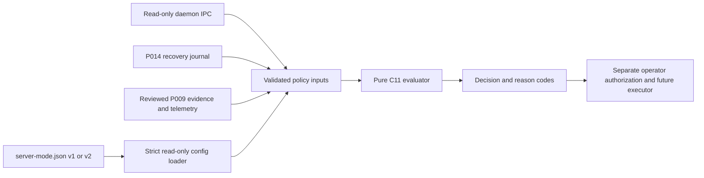

# P015 — Server Mode v2 Architecture

P015 adds a deterministic C11 policy layer. It evaluates a validated server configuration, one requested operation, current runtime observations, the P014 recovery journal, reviewed P009-compatible evidence, and resource-safety observations. It does not observe hardware directly or perform a runtime operation.

The last step is intentionally outside P015. A policy result never starts launchd, starts or restarts the daemon, obtains an assertion, wakes the iPad, writes configuration, changes networking, or creates a schedule.

## Interfaces

- `src/server_mode.c` retains the P006 path and file-safety checks while validating the strict v1 and v2 schemas.
- `src/server_policy.c` and `src/server_policy.h` expose the pure evaluator and versioned decision, gate, evidence, and reason types.
- The evaluator receives the P014 recovery store result and validated recovery record. Missing, unsafe, corrupt, unsupported, unresolved, or ownership-ambiguous recovery state blocks a bounded session.
- Runtime state is a read-only daemon IPC observation. Unknown status stays unknown. An active assertion blocks a second independently owned session.
- Hardware and resource gates require current, reviewed `DEVICE_REPORTED` or `EXTERNAL_OBSERVER` evidence. An `OPERATOR_RECORDED` source can pass only when a separate P009 review is represented; it is never promoted automatically. `SIMULATED`, `MOCK`, and `CI` inputs do not pass those gates.
- Evidence carries observation time, freshness, confidence, source, and review status. Unknown or low-confidence values are not replaced with optimistic defaults.
- `ic server policy show|validate|explain|plan|migrate --dry-run` only read state and write diagnostics to stdout.

Policy eligibility, a separate operator authorization, execution authorization, runtime activation, awake state, and network reachability are separate facts. The evaluator always sets `execution_authorized=no`. It reports runtime activation only when a current daemon observation reports an active daemon or owned assertion.

P004 schedule state remains in its existing store. A v2 policy file does not create, change, replay, or resume schedules. The P013 managed launchd profile remains `KeepAlive=false`; service mutation gates remain fail-closed.

## Current limits

No evidence-import format is added. The input structure is an interface for future trusted observation adapters, not a user-settable pass flag. P016 may populate battery and thermal observations after it defines a reviewed telemetry source and freshness contract. The config writer is gated; P015 does not offer `apply`.
